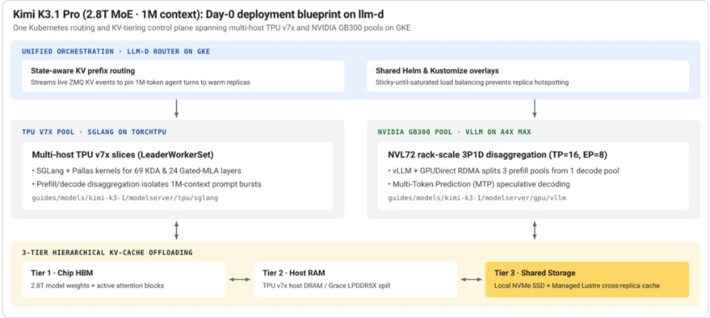
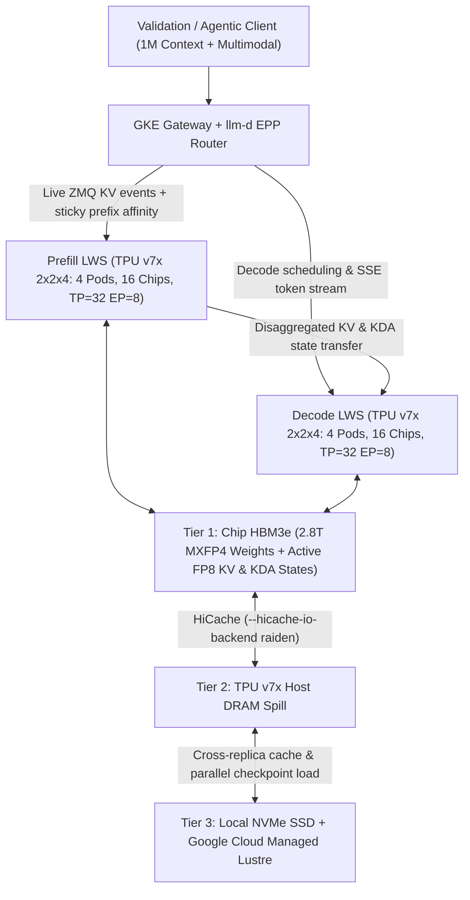

# Kimi K3.1 Pro on Cloud TPU v7x (Ironwood) with TorchTPU

End-to-end validation and deployment guide for running **Moonshot AI's Kimi K3 / Kimi K3.1 Pro** (`moonshotai/Kimi-K3.1-Pro`) on **Google Cloud TPU v7x (Ironwood)** using **TorchTPU**, **`SGLang-TorchTPU`**, **`LeaderWorkerSet`**, **3-tier hierarchical KV caching (HBM3e + Host DRAM + NVMe / Managed Lustre)**, and **`llm-d` on Google Kubernetes Engine (GKE)**.



---

## Table of Contents

1. [Model Architecture Specifications](#1-model-architecture-specifications)
2. [Google-Recommended TPU Architecture & Sizing](#2-google-recommended-tpu-architecture--sizing)
3. [Step-by-Step Deployment Workflow](#3-step-by-step-deployment-workflow)
   - [Phase 0: Preflight — Quotas, AI Zones & Capacity Discovery](#phase-0-preflight--quotas-ai-zones--capacity-discovery)
   - [Phase 1: Single-Host Compile & Pallas Kernel Smoke Test (Rung 0)](#phase-1-single-host-compile--pallas-kernel-smoke-test-rung-0)
   - [Phase 2: Provision GKE Standard, Networking, TPU v7x 2x2x4 Pools & 3-Tier Storage](#phase-2-provision-gke-standard-networking-tpu-v7x-2x2x4-pools--3-tier-storage)
   - [Phase 3: Deploy llm-d Router & SGLang-TorchTPU LeaderWorkerSet](#phase-3-deploy-llm-d-router--sglang-torchtpu-leaderworkerset)
4. [Systematic 5-Gate Validation Plan](#4-systematic-5-gate-validation-plan)
5. [Critical TPU v7x & TorchTPU Troubleshooting Gotchas](#5-critical-tpu-v7x--torchtpu-troubleshooting-gotchas)
6. [References](#6-references)

---

## 1. Model Architecture Specifications

Kimi K3.1 Pro is a natively multimodal Mixture-of-Experts (MoE) frontier model combining linear/recurrent **Kimi Delta Attention (KDA)** with **Gated Multi-head Latent Attention (MLA)** and **LatentMoE**:

| Component | Specification |
| :--- | :--- |
| **Model ID** | `moonshotai/Kimi-K3.1-Pro` / `moonshotai/Kimi-K3` |
| **Parameters** | **2.8T total**, **104B activated** per token |
| **Decoder Stack** | 93 layers (1 dense layer, hidden size `7168`, 96 attention heads, Attention Residuals) |
| **Hybrid Attention** | **69 Kimi Delta Attention (KDA)** linear/recurrent layers + **24 Gated-MLA** layers |
| **Context Window** | **1,048,576 tokens (1M context)** |
| **LatentMoE** | Latent dim `3584`, expert hidden size `3072`, **896 routed experts (top-16)** + **2 shared experts**, SiTU-GLU |
| **Vision Encoder** | **MoonViT-V2** (401M parameters; native text + image/video input) |
| **Vocabulary** | 160K |
| **Quantization** | **MXFP4 weights** + **MXFP8 activations** (QAT; ~1.4–1.6 TiB checkpoint with BF16 attention/shared experts) |

---

## 2. Google-Recommended TPU Architecture & Sizing

Because a ~1.5 TiB MXFP4 checkpoint plus 1M-token KV/recurrent state buffers exceed any single-host TPU memory footprint (`768 GiB` on one `tpu7x-standard-4t` node), single-host endpoints cannot host the full model. Google's recommended validation and production strategy follows two stages:

1. **Rung 0 — Fast Single-Host Smoke Test (Compute Engine TPU VM or 1-Pod `2x2x1` — 4 Chips / 8 TensorCores)**: Validate container setup, `torch_tpu` device registration, `torch.compile(backend="tpu")` token-bucket lowering, and custom Pallas KDA/Gated-MLA kernels using dummy or reduced-layer configs before allocating a multi-host slice.
2. **Full Model Validation & Production Serving (GKE Standard + `llm-d` + `LeaderWorkerSet` + `SGLang-TorchTPU` — 16 to 32 TPU v7x Chips)**: Deploy the Day-0 [`llm-d`](https://github.com/llm-d/llm-d) Kimi K3.1 blueprint (`guides/models/kimi-k3-1/modelserver/tpu/sglang`) on **GKE Standard** with state-aware ZMQ KV routing, Prefill/Decode (P/D) disaggregation, and 3-tier KV cache offloading.

> [!IMPORTANT]
> **Why `SGLang-TorchTPU` on TPU v7x?** While the NVIDIA GB300 pool in the heterogeneous `llm-d` blueprint runs vLLM, the **TPU v7x well-lit path uses `SGLang-TorchTPU`** (`sgl-project/sglang-torchtpu`, `SGLANG_PLATFORM=tpu_oot`). It integrates custom **Pallas megakernels** (`--attention-backend pallas_tpu_mla_sparse` and fused KDA recurrent-state kernels), native `kimi_k3` reasoning/tool-call parsers, RadixAttention prefix reuse, static prefill/decode bucket padding for `torch.compile`, and **`HiCache` (`--hicache-io-backend raiden`)** for high-bandwidth host-DRAM and shared-storage KV tiering.

### TPU v7x (Ironwood) Slice Geometry & Parallelism Math

Each physical TPU v7x chip is **dual-core** (exposing **2 logical TensorCores** to `torch_tpu`, 96 GiB HBM3e per core = **192 GiB/chip** at 7,380 GB/s), whereas Kubernetes `google.com/tpu` resource limits always count **physical chips**:

| Deployment Tier | Topology | `tpu7x-standard-4t` Hosts | Physical Chips (`google.com/tpu`) | Logical `torch_tpu` TensorCores | Total HBM3e | SGLang Parallelism |
| :--- | :--- | :--- | :--- | :--- | :--- | :--- |
| **Rung-0 Smoke Test** | `2x2x1` | 1 VM / Pod | 4 (`4` per pod) | **8** | 768 GiB | `TP=8` (dummy / reduced-layer compile check) |
| **1 Full Model Replica** | **`2x2x4`** | **4 pods** (`LWS size: 4`) | **16** (`4` × 4 pods) | **32** | **3,072 GiB (3 TiB)** | **`TP=32, EP=8`** (~1.5 TiB weights + ~1.1 TiB active FP8 KV/KDA) |
| **Day-0 Blueprint (2 Replicas / 1P1D)** | **2 × `2x2x4`** | **8 pods** (2 × `LWS`) | **32** | **64** | **6,144 GiB (6 TiB)** | **2 × (`TP=32, EP=8`)** — 2 sticky pools or 1 Prefill + 1 Decode |

### Request Lifecycle & 3-Tier KV Offload Dataflow



---

## 3. Step-by-Step Deployment Workflow

### Phase 0: Preflight — Quotas, AI Zones & Capacity Discovery

1. **Verify TPU v7x Service Usage Quota** (must pass the numeric `PROJECT_NUMBER`, not string `PROJECT_ID`; confirm at least **32** `tpu7x` chips for the 2-replica Day-0 blueprint, or **16** chips for a single `2x2x4` unified replica):
   ```bash
   export PROJECT_ID="<YOUR_PROJECT_ID>"
   export REGION="<YOUR_REGION>"          # e.g., us-central1 or us-south1
   export AI_ZONE="<YOUR_AI_ZONE>"        # e.g., us-south1-ai1b or us-central1-ai1a

   PROJECT_NUMBER=$(gcloud projects describe "${PROJECT_ID}" --format="value(projectNumber)")
   gcloud alpha services quota list \
     --service=tpu.googleapis.com \
     --consumer="projects/${PROJECT_NUMBER}" | grep -i tpu7x
   ```

2. **Enable AI Zone Visibility *Before* Creating the GKE Cluster** (required when targeting `<region>-ai*` zones):
   ```bash
   gcloud compute preview-features update ai-zones-visibility \
     --project="${PROJECT_ID}" \
     --activation-status=enabled \
     --rollout-plan=fast-rollout

   # Wait up to 15 minutes until the zone appears:
   gcloud compute zones list --project="${PROJECT_ID}" --filter="name=${AI_ZONE}"
   ```
   > **Important:** GKE clusters created *before* `ai-zones-visibility` finishes propagating will not register the AI zone in `cloud-controller-manager`, leaving TPU nodes stuck in `NotReady` (`nodes not found`). Always create a fresh regional GKE cluster after verifying zone visibility.

3. **Check TPU v7x Reservations or DWS Calendar Mode Capacity**:
   ```bash
   gcloud alpha compute tpus reservations list --zone="${AI_ZONE}" --project="${PROJECT_ID}"

   # Or query Dynamic Workload Scheduler (DWS) Calendar Mode availability for 32 TPU v7x chips:
   gcloud alpha compute advice calendar-mode \
     --project="${PROJECT_ID}" \
     --region="${REGION}" \
     --location-policy="${AI_ZONE}=ALLOW" \
     --tpu-version=TPU7X \
     --chip-count=32 \
     --workload-type=SERVING \
     --duration-range=min=1d,max=7d \
     --start-time-range=from=2026-11-10,to=2026-11-17 \
     --end-time-range=from=2026-11-11,to=2026-11-25
   ```

---

### Phase 1: Single-Host Compile & Pallas Kernel Smoke Test (Rung 0)

Before orchestrating 8 multi-host pods and staging ~1.5 TiB of weights, validate TorchTPU device discovery, XLA Tier-3 compilation caching, token-bucket padding, and Pallas KDA/Gated-MLA kernel compilation on a single `tpu7x-standard-4t` host (`2x2x1`, 4 physical chips = 8 TensorCores):

```bash
# On a single tpu7x-standard-4t TPU VM (4 chips / 8 TensorCores):
sudo sysctl -w vm.max_map_count=8388608
sudo rm -f /tmp/libtpu_lockfile

# Pull and launch the official TPU-enabled SGLang container:
docker pull lmsysorg/sglang:v0.1.0-tpu
docker run -it --rm --privileged --net=host --shm-size=64g \
  -e SGLANG_PLATFORM=tpu_oot \
  -e PJRT_DEVICE=TPU \
  -e TORCH_TPU_TIER3_COMPILATION_CACHE_ROOT=/tmp/torchtpu_cache \
  lmsysorg/sglang:v0.1.0-tpu bash

# Inside /sgl-workspace/sglang:
# 1. Confirm TorchTPU registers the native "tpu" device and detects all 8 logical TensorCores:
python3 -c "import torch, torch_tpu; print(torch.accelerator.current_accelerator(), torch.tpu.device_count())"

# 2. Run the Kimi K3 dummy/small-config TPU compile & Pallas megakernel test:
python3 -m benchmark.tpu.launch_server --config recipe/configs/kimi_k3/server.py --load-format dummy
```

> [!TIP]
> **Isolated Layer Numerical Parity:** If you also want to verify numerical parity of Kimi K3's 69 KDA layers, 24 Gated-MLA layers, and MoonViT-V2 vision encoder against the reference Hugging Face model before full serving, use TorchTitan's `models/kimi_k3` test suite (`scripts/checkpoint_conversion/numerical_tests_kimi_k3.py` in [`pytorch/torchtitan`](https://github.com/pytorch/torchtitan)).

---

### Phase 2: Provision GKE Standard, Networking, TPU v7x `2x2x4` Pools & 3-Tier Storage

1. **Create High-MTU VPC (`--mtu=8896`) & Regional GKE Standard Cluster**:
   - Use **GKE Standard** (`1.34.0-gke.2201000+`, or `1.35.2-gke.1842000+` if using GKE Dynamic Slicing on `>= 4x4x4` reservations). Avoid GKE Autopilot because multi-host `torch_tpu` pods require `hostNetwork: true`, `privileged: true`, and `vm.max_map_count` kernel tuning.
   ```bash
   gcloud compute networks create kimi-tpu-vpc \
     --project="${PROJECT_ID}" --subnet-mode=custom --mtu=8896

   gcloud compute networks subnets create kimi-tpu-sub \
     --project="${PROJECT_ID}" --network=kimi-tpu-vpc --region="${REGION}" \
     --range=10.10.0.0/20 --enable-private-ip-google-access

   gcloud compute firewall-rules create kimi-tpu-internal \
     --project="${PROJECT_ID}" --network=kimi-tpu-vpc \
     --allow tcp,udp,icmp --source-ranges=10.10.0.0/20

   gcloud container clusters create kimi-llmd-gke \
     --project="${PROJECT_ID}" --location="${REGION}" \
     --network=kimi-tpu-vpc --subnetwork=kimi-tpu-sub \
     --cluster-version=latest \
     --workload-pool="${PROJECT_ID}.svc.id.goog" \
     --addons=GcsFuseCsiDriver,LustreCsiDriver,HttpLoadBalancing \
     --gateway-api=standard
   ```

2. **Create Two `2x2x4` Multi-Host TPU v7x Node Pools** (4 hosts / 16 chips per pool = 32 chips total):
   - On `tpu7x-standard-4t`, do **not** pass `--tpu-topology` directly on `gcloud container node-pools create`, and always specify `--disk-type=hyperdisk-balanced`. First create a regional `HIGH_THROUGHPUT` workload policy:
   ```bash
   gcloud compute resource-policies create workload-policy wp-tpu7x-2x2x4 \
     --project="${PROJECT_ID}" \
     --region="${REGION}" \
     --type=HIGH_THROUGHPUT \
     --tpu-topology=2x2x4

   for POOL in a b; do
     gcloud container node-pools create "tpu7x-2x2x4-pool-${POOL}" \
       --project="${PROJECT_ID}" \
       --cluster=kimi-llmd-gke \
       --location="${REGION}" \
       --node-locations="${AI_ZONE}" \
       --machine-type=tpu7x-standard-4t \
       --disk-type=hyperdisk-balanced \
       --disk-size=500 \
       --local-nvme-ssd-block count=2 \
       --placement-policy=wp-tpu7x-2x2x4 \
       --reservation-affinity=specific \
       --reservation="projects/${PROJECT_ID}/reservations/<YOUR_RESERVATION_NAME>" \
       --enable-autoscaling --min-nodes=0 --max-nodes=4 \
       --scopes=https://www.googleapis.com/auth/cloud-platform
   done
   ```
   *(If you hold a Future Reservation in `All Capacity` mode with topology `>= 4x4x4` [64+ chips], configure a `provision_only` node pool with GKE Dynamic Slicing for sub-5-second optical sub-slice provisioning and hardware fault isolation.)*

3. **Install `LeaderWorkerSet` (LWS) CRDs**:
   ```bash
   kubectl apply --server-side \
     -f https://github.com/kubernetes-sigs/leaderworkerset/releases/latest/download/manifests.yaml
   ```

4. **Stage Checkpoint Weights & Configure Tier-3 Storage (Managed Lustre + Local NVMe)**:
   - Mount a **Google Cloud Managed Lustre** PersistentVolume (e.g., `/mnt/lustre`) alongside host Local NVMe (`/mnt/nvme`) across all TPU worker pods:
     - **Model checkpoint staging**: Download `moonshotai/Kimi-K3.1-Pro` once onto `/mnt/lustre/models/Kimi-K3.1-Pro` for high-throughput parallel weight streaming across all 8 hosts.
     - **Tier-3 shared KV cache**: Persists evicted 1M-context prefix blocks across replicas so cold or scaled-out replicas warm without recomputing multi-hundred-thousand-token prompts.
     - **Persistent TorchTPU Tier-3 compiler cache**: Point `TORCH_TPU_TIER3_COMPILATION_CACHE_ROOT=/mnt/lustre/torchtpu_cache` to cut XLA/Pallas bucket compilation from ~20–25 minutes on first boot to **< 90 seconds** on subsequent pod restarts.
   - *(If using GCS FUSE CSI instead of Managed Lustre for checkpoint reads, include `hostNetworkPodKSA=true` in `mountOptions` so GKE Workload Identity succeeds on `hostNetwork: true` pods.)*

---

### Phase 3: Deploy `llm-d` Router & `SGLang-TorchTPU` `LeaderWorkerSet`

Deploy the Day-0 recipe from [`llm-d`](https://github.com/llm-d/llm-d) (`guides/models/kimi-k3-1/`), which combines **Helm** for the state-aware KV router (`approx-prefix-cache-producer`, `prefix-cache-affinity-filter`, `token-load-scorer`) and **Kustomize** for the TPU `SGLang-TorchTPU` `LeaderWorkerSet`:

```bash
# 1. Clone llm-d and initialize guide variables
git clone https://github.com/llm-d/llm-d.git && cd llm-d
export REPO_ROOT=$(realpath $(git rev-parse --show-toplevel))
source "${REPO_ROOT}/guides/env.sh"

export GUIDE_NAME="kimi-k3-1"
export NAMESPACE="llm-d-kimi"
kubectl create namespace "${NAMESPACE}"

# 2. Install the state-aware llm-d Router (EPP streaming ZMQ KV events for sticky prefix routing)
#    For native GKE Gateway API integration, replace ${ROUTER_STANDALONE_CHART}
#    with ${ROUTER_GATEWAY_CHART} --set provider.name=gke
helm install "${GUIDE_NAME}-router" \
  "${ROUTER_STANDALONE_CHART}" \
  -f guides/recipes/router/base.values.yaml \
  -f guides/models/kimi-k3-1/router/tpu-sglang.values.yaml \
  -n "${NAMESPACE}"

# 3. Update PVC / HF token secret references in the overlay if needed, then apply the TPU SGLang stack:
kubectl apply -n "${NAMESPACE}" -k guides/models/kimi-k3-1/modelserver/tpu/sglang/
```

#### Mandatory `torch_tpu` Pod & `SGLang` Runtime Checklist

Confirm the `LeaderWorkerSet` (`size: 4` per `2x2x4` slice, `restartPolicy: RecreateGroupOnPodRestart`) applies these multi-host TorchTPU settings:

- **Pod spec requirements**:
  - `hostNetwork: true` and `dnsPolicy: ClusterFirstWithHostNet` (allows `libtpu` and `tpunetd` `SliceBuilder` to bind host NICs on ports `10000–10007` and ICI `8471`).
  - `securityContext.privileged: true` for `/dev/vfio/*` DMA access.
  - `initContainer` running `sysctl -w vm.max_map_count=8388608 && rm -f /tmp/libtpu_lockfile` (default Linux `vm.max_map_count=65530` fails when PjRt maps buffers across 32 TensorCores).
  - `ulimit -c 0` and a memory-backed `/dev/shm` `emptyDir` (`sizeLimit: 64Gi`).
  - `resources.limits["google.com/tpu"]: 4` per pod (4 physical chips = 8 TensorCores × 4 pods = `TP=32`).
- **Representative multi-host `SGLang-TorchTPU` server command** (per 4-host `2x2x4` replica):
  ```bash
  export SGLANG_PLATFORM=tpu_oot
  export PJRT_DEVICE=TPU
  export TORCH_TPU_TIER3_COMPILATION_CACHE_ROOT=/mnt/lustre/torchtpu_cache
  export LIBTPU_INIT_ARGS="--xla_tpu_scoped_vmem_limit_kib=65536"

  ulimit -c 0
  python3 -m sglang.launch_server \
    --model-path /mnt/lustre/models/Kimi-K3.1-Pro \
    --trust-remote-code \
    --tp-size 32 \
    --ep-size 8 \
    --nnodes 4 \
    --node-rank "${LWS_WORKER_INDEX}" \
    --dist-init-addr "${LWS_LEADER_ADDRESS}:20000" \
    --attention-backend pallas_tpu_mla_sparse \
    --kv-cache-dtype fp8_e4m3 \
    --mem-fraction-static 0.85 \
    --hicache-io-backend raiden \
    --hicache-ratio 2 \
    --max-running-requests 64 \
    --weight-loader-prefetch-checkpoints \
    --model-loader-extra-config '{"enable_multithread_load": true}' \
    --reasoning-parser kimi_k3 \
    --tool-call-parser kimi_k3 \
    --host 0.0.0.0 \
    --port 30000
  ```
  *(Note: Keep `--dist-init-addr` on port `20000` or `29501`; never use ports `8080`, `8431`, `8471`, or `10000–10007` reserved by `libtpu`/`tpunetd`. For Prefill/Decode disaggregation isolating 1M-context prompt bursts, deploy one `LWS` in prefill mode and the second `LWS` in decode mode as configured in the `llm-d` overlay.)*

---

## 4. Systematic 5-Gate Validation Plan

Run through these five validation gates sequentially once pods enter `Running` state:

### Gate 1: Static Bucket Warmup, Tier-3 Cache & Zero Recompilations
1. Stream leader logs:
   ```bash
   kubectl logs -n llm-d-kimi -l leaderworkerset.sigs.k8s.io/worker-index=0 -f
   ```
2. Wait for parallel MXFP4 checkpoint loading, `torch.compile` + Pallas kernel lowering across static prefill token-count and decode batch-size buckets, and `GET /health` returning `HTTP 200`.
3. Confirm compiled artifacts populate `/mnt/lustre/torchtpu_cache`. Perform one controlled rolling restart and verify startup compilation drops from ~20–25 min to **< 90s**.
4. Confirm zero unexpected dynamic-shape XLA recompilations appear in worker logs during live traffic.

### Gate 2: Functional Text, Reasoning, Tool Calling & Multimodal Sanity
Send OpenAI-compatible chat requests through the `llm-d` router endpoint (write JSON to a file to avoid quote-stripping over SSH hops):
```bash
cat << 'EOF' > /tmp/kimi_smoke.json
{
  "model": "moonshotai/Kimi-K3.1-Pro",
  "messages": [
    {
      "role": "user",
      "content": "Compute the HBM bandwidth roofline per token for a 104B-active MXFP4 MoE on a 16-chip TPU v7x 2x2x4 slice and summarize in JSON."
    }
  ],
  "max_tokens": 512,
  "temperature": 0.6
}
EOF

curl -s "http://${ROUTER_IP}:8000/v1/chat/completions" \
  -H "Content-Type: application/json" \
  -d @/tmp/kimi_smoke.json | jq .
```
Verify:
- Clean text completion without NaNs, garbled tokens, or premature EOS.
- Chain-of-thought separated into `reasoning_content` via `--reasoning-parser kimi_k3`.
- Structured function calls emitted into `tool_calls` via `--tool-call-parser kimi_k3`.
- Multimodal image + text prompt processed end-to-end through the **MoonViT-V2** encoder.

### Gate 3: Concurrent Accuracy & KDA Recurrent-State Isolation
> [!WARNING]
> **Hybrid Linear-Attention Validation Trap:** Unlike standard Transformer layers, Kimi K3.1's **69 KDA layers** maintain per-request recurrent state tensors alongside the 24 Gated-MLA paged KV blocks. Single-stream (`concurrency=1`) smoke tests can pass even if recurrent states fail to reset or leak across batch slots! Always run accuracy evaluations at **`concurrency >= 16`** across multi-turn conversations and `HiCache` evictions.

- Run standard evaluation suites (**MMLU-Pro**, **GSM8K / MATH-500**, **LiveCodeBench**) at `concurrency=16–32` and verify parity within ~0.5–1.0% of published `moonshotai/Kimi-K3.1-Pro` reference scores.

### Gate 4: 1M-Context Ramp, Sticky ZMQ Routing & 3-Tier KV Offload Stress
1. **Context scaling (`32K → 128K → 512K → 1M` tokens)**: Execute RULER / needle-in-a-haystack retrieval prompts up to 1,048,576 tokens; confirm exact retrieval and zero HBM or Scalar Memory (SMEM) `RESOURCE_EXHAUSTED` errors.
2. **State-aware prefix routing (`llm-d` EPP)**: Replay multi-turn long-context agent sessions; inspect EPP and SGLang metrics to confirm ZMQ KV events route follow-up turns to the warm replica (`> 90%` prefix hit rate and ~90%+ TTFT reduction on Turn 2+).
3. **3-Tier KV spill & reload**: Drive aggregate KV footprints past Tier-1 HBM capacity so `HiCache` (`--hicache-io-backend raiden`) spills inactive blocks to Tier-2 Host DRAM and Tier-3 NVMe / Managed Lustre, then resume evicted sessions and verify low reload TTFT with bitwise/semantic output consistency.
4. **Prefill/Decode disaggregation isolation**: Inject 512K–1M prompt prefill bursts while measuring steady-state decode clients; confirm decode Inter-Token Latency (ITL) remains stable without prefill stalls.

### Gate 5: SLA Throughput/Latency Sweeps & `torch.profiler` / XProf Profiling
1. **Load sweeps**: Run `python3 -m sglang.bench_serving` (or `llm-d`'s `inference-perf` harness) across workload mixes (`1K/1K`, `32K/2K`, `128K/1K` multi-turn agentic) at concurrencies `[1, 4, 8, 16, 32, 64]`, recording:
   - **TTFT** (p50 / p95 / p99)
   - **ITL / TPOT** (p50 / p95 / p99) and single-stream tok/s
   - **Total output tokens/sec** and **tokens/sec per TPU v7x chip**
2. **XProf hardware trace review**: Capture isolated prefill and decode steps via `torch.profiler` and inspect in TensorBoard **XProf** to confirm high TensorCore MXU utilization inside `pallas_tpu_mla_sparse` + KDA megakernels, zero unintended host sync barriers per token, and clean overlap of `TP=32 / EP=8` collectives across TPU v7x intra-chip (`1.6 TB/s`) and 3D-Torus ICI (`1.2 TB/s/chip`) interconnects.

---

## 5. Critical TPU v7x & TorchTPU Troubleshooting Gotchas

| Area | Common Pitfall (Do NOT Do) | Recommended Fix | Root Cause |
| :--- | :--- | :--- | :--- |
| **TPU v7x GKE Node Pools** | Passing `--tpu-topology=2x2x4` directly to `node-pools create` or using `pd-balanced` boot disks on `tpu7x-standard-4t`. | Create a regional `HIGH_THROUGHPUT` workload policy (`--tpu-topology=2x2x4`), pass `--placement-policy=<NAME>`, and set `--disk-type=hyperdisk-balanced`. | GKE rejects direct `--tpu-topology` and `pd-*` disk types on `tpu7x-standard-4t`. |
| **AI Zones (`*-ai*`)** | Enabling `ai-zones-visibility` *after* creating the GKE cluster. | Enable `ai-zones-visibility`, confirm via `gcloud compute zones list`, then create a **new** regional GKE cluster. | Existing GKE control planes do not retroactively register newly visible AI zones (`nodes not found`). |
| **Chip vs. Core Counts** | Requesting `google.com/tpu: 8` per `tpu7x-standard-4t` pod because `torch_tpu` sees 8 devices. | Request `google.com/tpu: 4` per `tpu7x-standard-4t` pod (`4` physical chips × 4 pods = 16 chips = **32 logical TensorCores** for `TP=32`). | Kubernetes schedules physical chips (`4`/host), whereas dual-core TPU v7x exposes 2 TensorCores per chip (`8`/host) to PyTorch. |
| **PjRt VMA Exhaustion** | Running multi-host pods with default Linux `vm.max_map_count` (`65530`) or missing `hostNetwork: true`. | Run `sysctl -w vm.max_map_count=8388608` in a privileged `initContainer`, plus `hostNetwork: true` and `dnsPolicy: ClusterFirstWithHostNet`. | PjRt/HBM buffer mappings across 32 TensorCores exceed 65K VMAs (`Out of memory` despite free HBM), and `tpunetd` requires host NIC ports `10000–10007`. |
| **Rendezvous Port Collisions** | Setting `--dist-init-addr` to port `8080`, `8431`, `8471`, or `10000–10007`. | Use port `20000` or `29501` for PyTorch/SGLang rendezvous. | Ports `10000–10007` and `8471` collide with `libtpu` / `tpunetd` `SliceBuilder`. |
| **GCS FUSE + `hostNetwork`** | Mounting GCS FUSE CSI volumes on `hostNetwork: true` pods without pod-level KSA opt-in. | Add `hostNetworkPodKSA=true` to CSI `mountOptions` (or stage weights on Managed Lustre). | GKE Metadata Server blocks Workload Identity token exchange on host-networked pods unless `hostNetworkPodKSA=true` is enabled. |

---

## 6. References

- **TorchTPU (Native PyTorch Backend for Cloud TPU)**: [github.com/google-pytorch/torch_tpu](https://github.com/google-pytorch/torch_tpu)
- **Google Cloud TPU PyTorch Documentation**: [docs.cloud.google.com/tpu/docs/pytorch-stack](https://docs.cloud.google.com/tpu/docs/pytorch-stack)
- **`llm-d` Kimi K3.1 Day-0 Recipe**: [github.com/llm-d/llm-d](https://github.com/llm-d/llm-d) (`guides/models/kimi-k3-1/modelserver/tpu/sglang` & `guides/models/kimi-k3-1/router/tpu-sglang.values.yaml`)
- **SGLang-TorchTPU Backend & Kimi K3 Recipes**: [github.com/sgl-project/sglang-torchtpu](https://github.com/sgl-project/sglang-torchtpu)
- **AI Hypercomputer Ironwood TPU Recipes**: [github.com/AI-Hypercomputer/tpu-recipes](https://github.com/AI-Hypercomputer/tpu-recipes)
- **Kimi K3 / K3.1 Model Card**: [huggingface.co/moonshotai/Kimi-K3](https://huggingface.co/moonshotai/Kimi-K3)
- **TorchTitan Kimi K3 Reference & Parity Tests**: [github.com/pytorch/torchtitan](https://github.com/pytorch/torchtitan)
