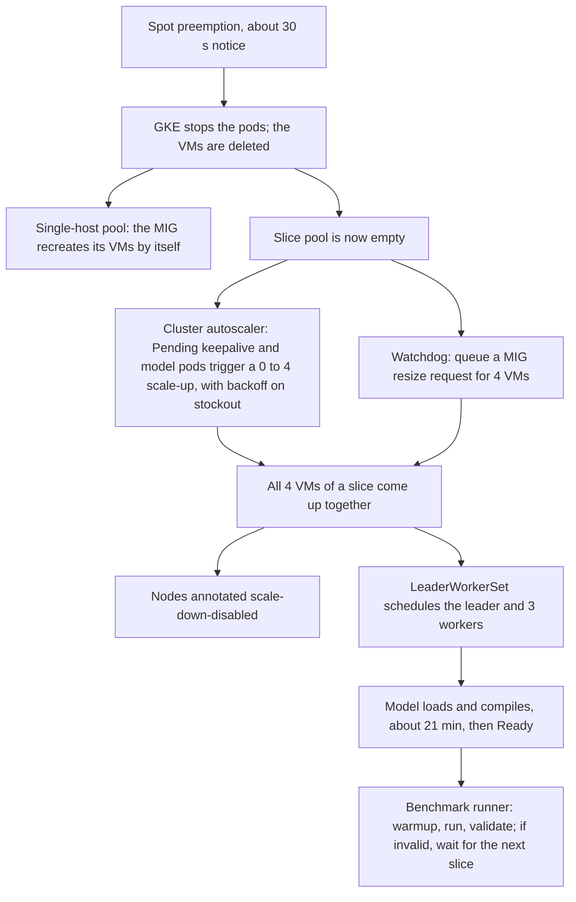

# Spot TPU v7x on GKE: node pool commands and preemption retry logic

What we used to bring up Kimi K3.1 Pro on Spot TPU v7x (`tpu7x-standard-4t`, 4 chips per VM) on GKE Standard. Replace the placeholders in the variables block. Every command below is one we ran; only names were changed.

## 1. Variables

```bash
export PROJECT_ID=<your-project>
export REGION=us-central1          # region we tested in; use one where you have Spot TPU v7x quota
export ZONE=us-central1-c
export CLUSTER_NAME=<your-cluster>
```

Cluster we used, for reference (GKE Standard, 1.36.5-gke.1982000, Rapid channel):

```bash
gcloud container clusters create ${CLUSTER_NAME} \
  --project=${PROJECT_ID} \
  --zone=${ZONE} \
  --release-channel=rapid \
  --cluster-version=1.36.5-gke.1982000 \
  --machine-type=e2-standard-8 \
  --num-nodes=2 \
  --disk-type=pd-balanced \
  --disk-size=100 \
  --network=default \
  --subnetwork=default \
  --enable-ip-alias \
  --cluster-ipv4-cidr=/17 \
  --workload-pool=${PROJECT_ID}.svc.id.goog \
  --addons=GcsFuseCsiDriver,HttpLoadBalancing,HorizontalPodAutoscaling \
  --gateway-api=standard \
  --scopes=https://www.googleapis.com/auth/cloud-platform
```

## 2. Node pools

### 2.1 Multi-host 16-chip slice pools (`2x2x4` = 4 VMs)

The full model needs one 16-chip ICI slice. We kept two identical slice pools so that whichever got capacity first could serve. Each pool has its own workload policy.

```bash
for S in a b; do
  # Workload policy: replaces --tpu-topology for TPU v7x multi-host slices.
  gcloud compute resource-policies create workload-policy tpu7x-2x2x4-wp-${S} \
    --project=${PROJECT_ID} \
    --region=${REGION} \
    --type=HIGH_THROUGHPUT \
    --accelerator-topology=2x2x4

  # Created EMPTY (0 VMs). It scales 0 <-> 4 as one atomic unit.
  gcloud container node-pools create tpu7x-2x2x4-spot-${S} \
    --project=${PROJECT_ID} \
    --cluster=${CLUSTER_NAME} \
    --zone=${ZONE} \
    --node-locations=${ZONE} \
    --machine-type=tpu7x-standard-4t \
    --spot \
    --reservation-affinity=none \
    --placement-policy=tpu7x-2x2x4-wp-${S} \
    --disk-type=hyperdisk-balanced \
    --disk-size=200 \
    --num-nodes=0 \
    --enable-autoscaling --min-nodes=0 --max-nodes=4 \
    --scopes=https://www.googleapis.com/auth/cloud-platform
done
```

### 2.2 Single-host 4-chip pool (`2x2x1`, optional)

We used this pool for 12-layer tests and spare capacity: 5 VMs = 20 chips. Separate single-host VMs do not form an ICI slice, so they cannot serve the full model.

```bash
gcloud container node-pools create tpu7x-2x2x1-spot \
  --project=${PROJECT_ID} \
  --cluster=${CLUSTER_NAME} \
  --zone=${ZONE} \
  --node-locations=${ZONE} \
  --machine-type=tpu7x-standard-4t \
  --spot \
  --reservation-affinity=none \
  --disk-type=hyperdisk-balanced \
  --disk-size=200 \
  --num-nodes=5 \
  --scopes=https://www.googleapis.com/auth/cloud-platform

# Change the size later with:
gcloud container clusters resize ${CLUSTER_NAME} --node-pool=tpu7x-2x2x1-spot --num-nodes=5 \
  --zone=${ZONE} --project=${PROJECT_ID}
```

**Scheduling.**
- Node labels: `cloud.google.com/gke-tpu-accelerator: tpu7x` and `cloud.google.com/gke-tpu-topology: 2x2x4`.
- Pods must tolerate the taints `google.com/tpu=present:NoSchedule` and `cloud.google.com/gke-spot=true:NoSchedule`.

### 2.3 Errors we hit

| What we tried | Result | What works |
| --- | --- | --- |
| `--tpu-topology=2x2x4` on `tpu7x-standard-4t` | `INVALID_ARGUMENT: Use workload policy instead` | Workload policy + `--placement-policy` (2.1) |
| Placement policy on a single-host `2x2x1` pool | Rejected | No placement policy for single-host (2.2) |
| `pd-balanced` / `pd-standard` boot disk | Unsupported on `tpu7x-standard-4t` | `--disk-type=hyperdisk-balanced` |
| Creating the slice pool with `--num-nodes=4` | `GCE_STOCKOUT: Atomic resize failed`; the pool was left in ERROR and had to be deleted | Create with `--num-nodes=0`, then get capacity as in section 3 |
| `gcloud container clusters resize` on the slice pool | `Unimplemented: Multi-host TPU pool (...) manual resize is not supported.` | MIG resize request (section 3) |
| `gcloud compute instance-groups managed resize <MIG> --size=4` | `Managed Instance Group in the gang mode can only be resized to zero.` | `gcloud compute instance-groups managed resize-requests create <MIG> --resize-by=4` |
| DWS Flex-start (`--flex-start --enable-queued-provisioning`) | Not usable for TPU v7x in our project during testing; queued provisioning also does not support Spot | Not used |

## 3. Retry logic after a preemption

Spot VMs get about 30 s notice; GKE stops the pods and the VMs are deleted. Recovery then runs on its own at three levels: capacity, Kubernetes and benchmark.



### 3.1 Single-host pool: nothing to do

The pool has a fixed size of 5 and autoscaling off. When a Spot VM is preempted, its MIG keeps recreating it under the same name until capacity returns. Overnight our single-host VMs went down and came back dozens of times with no intervention.

### 3.2 Slice pools: three mechanisms

**a) Keepalive pods, which keep the cluster autoscaler trying.** We ran one Deployment per slice pool. Its 4 `pause` pods have a nodeSelector for the pool and one-per-node anti-affinity, and they request no TPU chips.
- While the pool is empty they stay Pending, so the autoscaler keeps trying to scale the slice up, even when no model is deployed.
- Because they request no chips, they never block the model.
- On stockout the autoscaler backs off, which is why we also use (b).

```yaml
apiVersion: apps/v1
kind: Deployment
metadata:
  name: tpu-2x2x4-keepalive-a      # repeat with -b for the second pool
spec:
  replicas: 4                      # one per VM of a 2x2x4 slice
  selector:
    matchLabels:
      app: tpu-2x2x4-keepalive-a
  template:
    metadata:
      labels:
        app: tpu-2x2x4-keepalive-a
    spec:
      nodeSelector:
        cloud.google.com/gke-nodepool: tpu7x-2x2x4-spot-a
        cloud.google.com/gke-tpu-accelerator: tpu7x
        cloud.google.com/gke-tpu-topology: 2x2x4
      affinity:
        podAntiAffinity:
          requiredDuringSchedulingIgnoredDuringExecution:
          - labelSelector:
              matchLabels:
                app: tpu-2x2x4-keepalive-a
            topologyKey: kubernetes.io/hostname
      tolerations:
      - key: google.com/tpu
        operator: Equal
        value: present
        effect: NoSchedule
      - key: cloud.google.com/gke-spot
        operator: Equal
        value: "true"
        effect: NoSchedule
      containers:
      - name: pause
        image: registry.k8s.io/pause:3.9
        resources:
          requests:
            cpu: 10m
            memory: 16Mi
```

**b) Queued MIG resize requests, re-armed by a watchdog.** This is the main path. A resize request asks GCE for all 4 VMs of the slice at once; GCE queues it and fills it when capacity exists.
- If a request ends without capacity, the next watchdog pass queues a new one.
- To find the MIG behind a pool:

```bash
gcloud container node-pools describe tpu7x-2x2x4-spot-a --cluster=${CLUSTER_NAME} --zone=${ZONE} \
  --project=${PROJECT_ID} --format='value(instanceGroupUrls[0].basename())'
```

The watchdog below is a cleaned-up, parameterized version of the loop we ran. Besides (b), it also does (c) and the LeaderWorkerSet cleanup from 3.3.

```bash
#!/usr/bin/env bash
# tpu7x_spot_watchdog.sh - keep Spot TPU v7x capacity coming back after preemptions (GKE Standard).
#   1) Every multi-host slice node pool that has 0 VMs and no queued request gets a new GCE MIG resize request
#      for one full slice. GCE queues the request and creates all VMs of the slice together once capacity exists.
#   2) TPU nodes are annotated against cluster-autoscaler scale-down as soon as they join.
#   3) LeaderWorkerSet pods stuck on deleted / NotReady nodes are force-deleted so LWS recreates the group at once.
# Single-host Spot pools need nothing: their MIG recreates preempted VMs on its own.
#
# Usage:
#   PROJECT_ID=my-project ZONE=us-central1-c CLUSTER_NAME=my-cluster \
#   SLICE_POOLS="tpu7x-2x2x4-spot-a tpu7x-2x2x4-spot-b" NAMESPACE=my-namespace LWS_NAME=my-lws \
#   ./tpu7x_spot_watchdog.sh
#   DRY_RUN=1 prints the actions without changing anything; ONCE=1 runs a single pass and exits.
set -u
: "${PROJECT_ID:?set PROJECT_ID}" "${ZONE:?set ZONE}" "${CLUSTER_NAME:?set CLUSTER_NAME}" "${SLICE_POOLS:?set SLICE_POOLS}"
NODES_PER_SLICE=${NODES_PER_SLICE:-4}   # 2x2x4 = 16 chips = 4 x tpu7x-standard-4t VMs
NAMESPACE=${NAMESPACE:-}                # namespace of the model's LeaderWorkerSet (optional)
LWS_NAME=${LWS_NAME:-}                  # name of the model's LeaderWorkerSet (optional)
INTERVAL=${INTERVAL:-120}               # seconds between passes
DRY_RUN=${DRY_RUN:-0}
ONCE=${ONCE:-0}

run() { if [ "$DRY_RUN" = 1 ]; then echo "DRY_RUN: $*"; else "$@"; fi; }
log() { echo "$(date -u +%FT%TZ) $*"; }

while true; do
  # 1) Re-arm empty slice pools with a queued, all-or-nothing resize request.
  for POOL in $SLICE_POOLS; do
    MIG=$(gcloud container node-pools describe "$POOL" --cluster="$CLUSTER_NAME" --zone="$ZONE" \
            --project="$PROJECT_ID" --format='value(instanceGroupUrls[0].basename())')
    VMS=$(gcloud compute instance-groups managed list-instances "$MIG" --zone="$ZONE" \
            --project="$PROJECT_ID" --format='value(name)' | wc -l)
    QUEUED=$(gcloud compute instance-groups managed resize-requests list "$MIG" --zone="$ZONE" \
            --project="$PROJECT_ID" --filter='state=ACCEPTED' --format='value(name)' | tr '\n' ' ')
    log "$POOL: vms=$VMS queued=${QUEUED:-none}"
    if [ "$VMS" -eq 0 ] && [ -z "$QUEUED" ]; then
      log "$POOL is empty -> queueing a resize request for $NODES_PER_SLICE VMs"
      run gcloud compute instance-groups managed resize-requests create "$MIG" \
        --resize-request="retry-$(date -u +%Y%m%d-%H%M%S)" --resize-by="$NODES_PER_SLICE" \
        --zone="$ZONE" --project="$PROJECT_ID"
    fi
  done

  # 2) Keep granted TPU nodes from being scaled down while idle (e.g. between model restarts).
  run kubectl annotate nodes -l cloud.google.com/gke-tpu-accelerator=tpu7x \
    cluster-autoscaler.kubernetes.io/scale-down-disabled=true --overwrite > /dev/null 2>&1 || true

  # 3) Free LeaderWorkerSet pods left on nodes that were deleted or went NotReady after a preemption.
  if [ -n "$NAMESPACE" ] && [ -n "$LWS_NAME" ]; then
    kubectl get pods -n "$NAMESPACE" -l leaderworkerset.sigs.k8s.io/name="$LWS_NAME" \
      -o jsonpath='{range .items[*]}{.metadata.name}{" "}{.status.phase}{" "}{.spec.nodeName}{"\n"}{end}' |
    while read -r POD PHASE NODE; do
      [ -z "$NODE" ] && continue          # Pending pods have no node yet
      READY=$(kubectl get node "$NODE" -o jsonpath='{.status.conditions[?(@.type=="Ready")].status}' 2> /dev/null)
      if [ -z "$READY" ] || { [ "$PHASE" = "Failed" ] && [ "$READY" != "True" ]; }; then
        log "force-deleting $POD (phase=$PHASE, node $NODE gone or NotReady)"
        run kubectl delete pod "$POD" -n "$NAMESPACE" --grace-period=0 --force
      fi
    done
  fi

  [ "$ONCE" = 1 ] && break
  sleep "$INTERVAL"
done
```

Try it first with `DRY_RUN=1 ONCE=1`. The script needs the gcloud permission to update managed instance groups (to create resize requests), plus kubectl access to nodes and pods.

**c) Scale-down lock.** As each TPU node joins, it is annotated `cluster-autoscaler.kubernetes.io/scale-down-disabled=true`. Otherwise the autoscaler can remove a slice that just arrived while it is idle, for example during a model restart. We ran this as a small in-cluster loop (every 10 s); the watchdog's step 2 does the same.

### 3.3 Kubernetes level: LeaderWorkerSet

- **One group per slice.** The model runs as a LeaderWorkerSet: 1 leader + 3 workers, one pod per VM of a `2x2x4` slice. With two slice pools armed and `replicas: 1`, the group lands on whichever slice comes up first, and the other slice is a hot spare.
- **Automatic recreation.** After a preemption the LWS controller recreates the group. The leader stays Pending until a full slice is Ready.
- **Stuck pods.** Pods sometimes stay Failed/Terminating on nodes that no longer exist and block the recreation. The watchdog's step 3 force-deletes them.
- **Rollouts.** Set `rolloutStrategy.rollingUpdateConfiguration.maxUnavailable` to at least the replica count. With the default of 1, a template change stalled while one group could not be scheduled.
- **Shorter restarts.** Each restart is a full cold start, so we shortened it:
  - a persistent compile cache on GCS shared by all ranks (one shared directory);
  - compiling only the batch sizes we need;
  - skipping the vision-encoder precompile for text-only serving.

  Time from slice grant to Ready dropped from about 38 to about 21 min.

### 3.4 Benchmark level (optional)

Our benchmark runner loops until it has a valid result:
1. Wait for the leader to be Ready.
2. Send a warmup request; it must succeed and the leader must still be Ready.
3. Run the benchmark job.
4. Accept the report only if at least 99% of requests succeeded.

If the slice is lost mid-run, the report is marked invalid and the runner waits for the next slice.

## 4. What to expect on Spot (our observations)

- **Grants:** `2x2x4` Spot slices were granted every 10–50 min. Lifetimes ranged from about 3 to 79 min, and over the last ~12 hours most were reclaimed within 3–25 min.
- **Startup cost:** each slice needs about 21 min to load and compile the model before it can serve, and a benchmark needs another ~15 min. So many granted slices never produced results.
- **Recommendation:** Spot works for bring-up and validation. For sustained serving or long benchmarks, use reserved or on-demand capacity, or DWS Flex-start where available.

## 5. Recommendations

- **Where to run the watchdog:** run it in-cluster, as a Deployment or CronJob with Workload Identity, with an interval of 1–2 min. We ran it every 10 min from a workstation via cron; once, no checks ran for ~3.5 h. During that time nobody re-queued resize requests, and no slice was granted.
- **Arm more than one slice pool:** this raises the chance of getting a slice, and the extra slice doubles as a hot spare.
